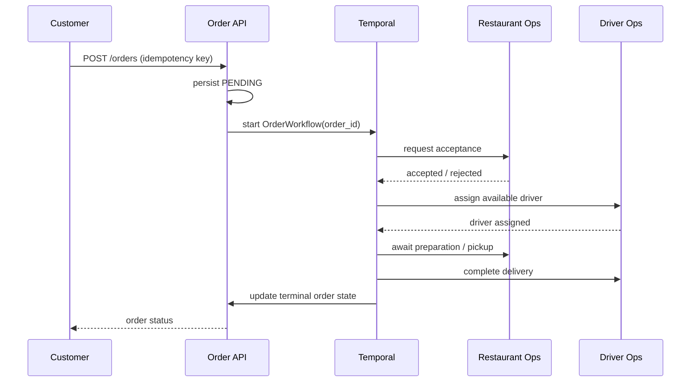

# Architecture

## Bounded contexts and ownership

- **User/Auth**: identity, credentials, access tokens and customer profiles. PostgreSQL is authoritative.
- **Catalog**: restaurant/menu write model and Elasticsearch read index. Catalog owns index mappings and reindexing.
- **Search**: query-only API over Elasticsearch; it does not own catalog data. Catalog changes are projected into search documents.
- **Restaurant Ops**: restaurant-side order acceptance, preparation and ready-for-pickup state. PostgreSQL is authoritative.
- **Driver Ops**: driver presence, availability, assignment, pickup and drop-off state. PostgreSQL is authoritative.
- **Order API**: customer-facing order commands and order record. It starts workflows and exposes order status.
- **Temporal worker**: durable process manager for the long-running order saga.

## Order saga

Temporal workflow code must be deterministic: no direct network, database, random or wall-clock calls in workflow functions. Put I/O in activities. Use workflow timers, signals and retries for durable waits. Every activity that changes state must accept an idempotency key (normally order ID plus operation).

## Data and messaging

PostgreSQL owns transactional state. Elasticsearch is a derived search index, never the source of truth for operational transactions. Redis is for cache/rate-limit/ephemeral coordination only. Kafka carries integration events such as `catalog.restaurant-upserted.v1`, `restaurant.order-accepted.v1` and `driver.location-updated.v1`; use an outbox in each Postgres-owning service to avoid dual-write loss.

## Production additions

API gateway, service-to-service auth, secrets manager, database-per-service, migrations, transactional outbox/inbox, payment provider adapter, maps/geocoding, driver geo-index (Redis GEO), tracing (OpenTelemetry), metrics (Prometheus), structured logs, rate limiting, DLQs and CI security scanning.
